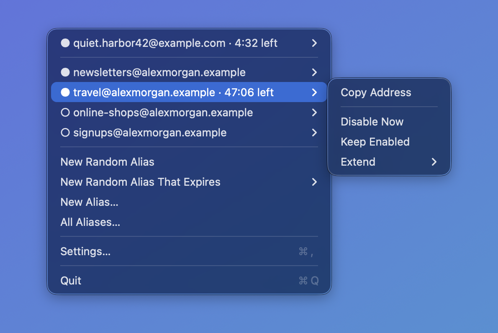
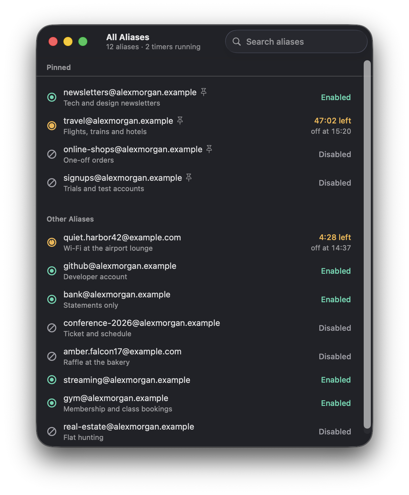
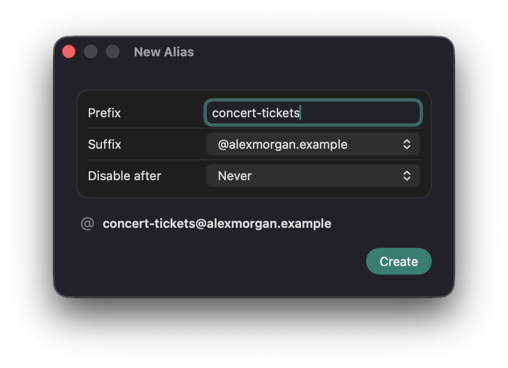
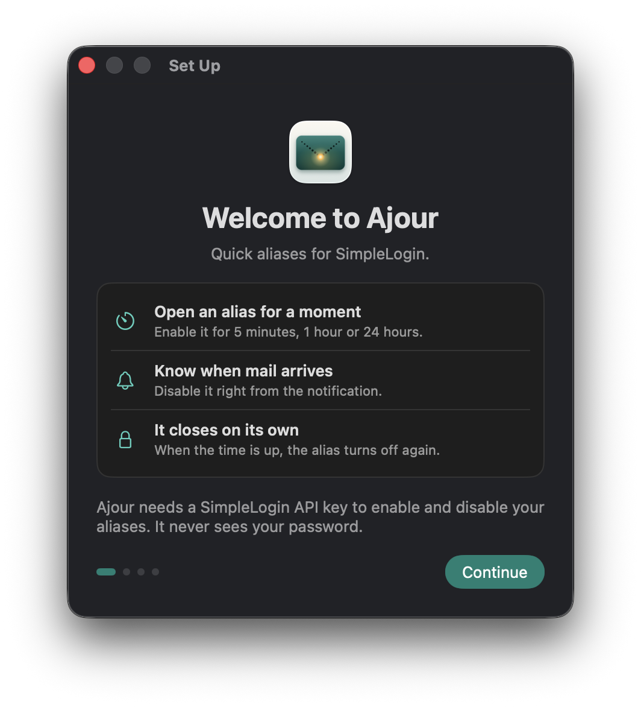

<h1 align="center">Ajour</h1>

<p align="center">
  <strong>Quick aliases for SimpleLogin, right in your Mac's menu bar.</strong>
</p>

<p align="center">
  <a href="https://github.com/JonasDoebertin/ajour/actions/workflows/ci.yml"></a>
  
  <a href="LICENSE"></a>
</p>

<p align="center">
  
</p>

Some websites send nothing but spam, so you keep their [SimpleLogin](https://simplelogin.io) alias disabled. Then you need to log in, the site emails you a login code, and you have to open the SimpleLogin dashboard, enable the alias, wait for the mail, and remember to disable it again.

Ajour turns that into two clicks. Pick the alias in the menu bar, enable it for 5 minutes, and log in. When the mail arrives, a notification offers to disable the alias right away. If you ignore it, Ajour disables the alias when the time is up.

## Features

- **Enable aliases for a while.** Turn any pinned alias on for 5 minutes, 1 hour, or 24 hours. The menu counts down the time left, and you can extend the timer, keep the alias enabled, or disable it early.
- **Know when mail arrives.** While a timer runs, Ajour checks the alias every 15 seconds and notifies you about new mail, with a Disable Now button in the notification.
- **Never leave an alias on by accident.** If your Mac is asleep or Ajour isn't running when a timer ends, the alias is disabled right after wake or at the next launch. Quitting Ajour disables timed aliases first. When disabling keeps failing, Ajour tells you and keeps trying.
- **Create aliases fast.** One click creates a random alias and copies it to the clipboard, optionally with an expiry. The New Alias window takes your own prefix and offers your custom domains first.
- **Find any alias.** The All Aliases window searches your whole account. Right-click an alias to pin it to the menu, copy it, or enable or disable it.
- **Stay out of the way.** Ajour lives in the menu bar, has no Dock icon, and can start at login.

<table>
  <tr>
    <td width="50%"></td>
    <td width="50%"><br></td>
  </tr>
</table>

## Install

You need macOS 26 or later and a SimpleLogin account.

1. Download `Ajour-<version>.zip` from the [latest release](https://github.com/JonasDoebertin/ajour/releases/latest), unzip it, and move `Ajour.app` to your Applications folder.
2. Open Ajour. Because the app isn't notarized by Apple, macOS blocks it the first time. Open System Settings > Privacy & Security, scroll down, and choose Open Anyway.
3. Follow the setup window. It takes you to SimpleLogin to create an API key and offers to use the key from your clipboard when you come back.

After an update, macOS may ask whether Ajour may use its key in the Keychain. Choose Always Allow.

## Privacy and security

- Ajour signs in with an API key, never with your password. The key is stored in your Keychain and nowhere else.
- The app only talks to `app.simplelogin.io`. It has no analytics and no third-party dependencies.
- It runs in the App Sandbox, with outgoing network connections as its only entitlement.
- SimpleLogin can't disable an alias on a schedule, so the timers run on your Mac. If the Mac sleeps through the end of a timer, the alias stays enabled until it wakes and Ajour is running.

## Build from source

You need Xcode 27.1 and [XcodeGen](https://github.com/yonaskolb/XcodeGen).

```sh
brew install xcodegen
xcodegen generate
open Ajour.xcodeproj
```

The Xcode project is generated from `project.yml` and not checked in. Logic that doesn't need the UI, such as the API client and the timer engine, lives in the `SimpleLoginKit` package in `Packages/`.

Run the tests:

```sh
swift test --package-path Packages/SimpleLoginKit
xcodebuild test -project Ajour.xcodeproj -scheme Ajour -destination "platform=macOS"
```

Debug builds have a demo mode with a made-up account, so you can try the UI without an API key: pass `-AjourDemo YES` as a launch argument, or add `-AjourDemoSignedOut YES` to start at onboarding. The screenshots in this README come from demo mode via `swift scripts/take-screenshots.swift <path to Debug Ajour.app> docs/images`.

[docs/ci.md](docs/ci.md) explains the CI pipeline and how releases are made.

## Contributing

Bug reports and ideas are welcome in [Issues](https://github.com/JonasDoebertin/ajour/issues), which also hold the plans for what comes next, such as a global keyboard shortcut, Shortcuts actions, and support for self-hosted SimpleLogin.

## License

Ajour is available under the [MIT License](LICENSE).

Ajour is an independent app and is not affiliated with SimpleLogin or Proton AG.
